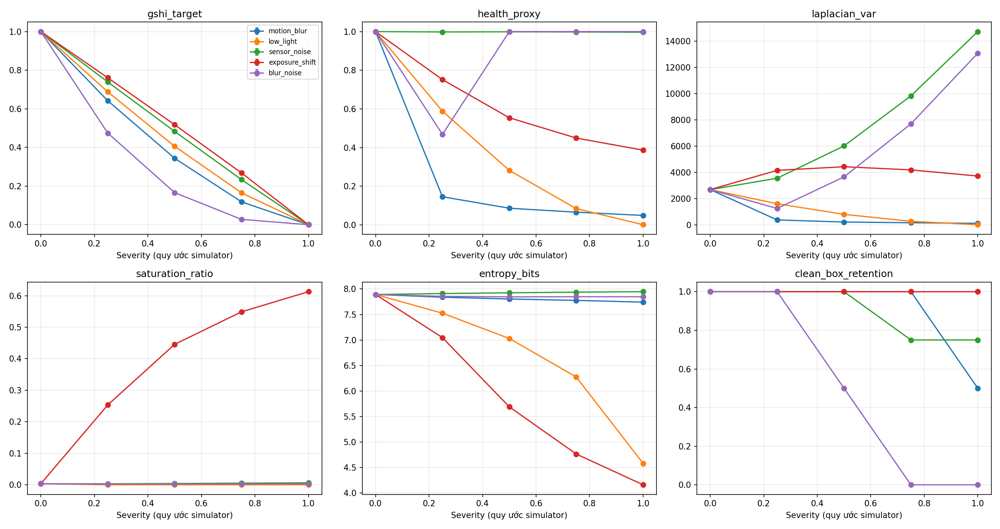

# Báo cáo cá nhân — Nguyễn Hoàng Cường

- Họ tên: Nguyễn Hoàng Cường
- MSSV: 2A202602473
- Tên nhóm: [CẦN ĐIỀN]
- URL repository chung: [ĐIỀN URL SAU KHI PUSH]
- Phân công đề xuất: Kiểm tra tính đầy đủ của log/CSV/ảnh/plot, đối chiếu rubric, tổng hợp báo cáo và kiểm tra liên kết bài nộp.

Báo cáo sử dụng kết quả chung đã cung cấp. Phân công là đề xuất, người nộp điều chỉnh cho đúng công việc thực tế. Không coi việc sắp xếp và viết báo cáo là một lần chạy benchmark mới.

## 1. Problem

Xe ADAS, camera RGB, nhận diện đối tượng đường phố và giám sát chất lượng đầu vào. Failure chính: blur kết hợp noise có thể làm metric sắc nét đánh giá sai.

**Claim ban đầu để kiểm tra:** Khi tăng motion blur trên cùng ảnh, Laplacian variance dự kiến giảm và detector consistency có thể giảm; thêm noise có thể làm proxy dựa trên Laplacian bỏ sót suy giảm. Baseline là ảnh sạch; severity 0,25/0,50/0,75/1,00 là điều kiện lỗi có kiểm soát.

## 2. Method

Tham chiếu [Aher, arXiv:2605.05439v1](https://arxiv.org/html/2605.05439v1). Benchmark chỉ tái hiện GSHI target và ý tưởng severity sweep bằng simulator giản lược, bổ sung health proxy cần ảnh sạch và YOLOv8n cố định. GSHI được tính từ severity, chưa huấn luyện mô hình dự đoán health từ ảnh. Input/output, định nghĩa metric và cách chạy nằm ở [Method](../docs/METHOD_AND_REPRODUCIBILITY.md).

Code: [notebook](../notebooks/camera_health_lab_colab.ipynb). Chạy Google Colab > Runtime > Run all. Version/config: [benchmark.json](../configs/benchmark.json); seed 42. Chưa có commit/hash weights của lần chạy cũ.

## 3. Benchmark

Một ảnh bus.jpg từ Ultralytics, cạnh dài 640 px; 21 mẫu raw gồm 1 baseline + 5 mode × 4 severity. YOLO confidence ≥0,25; matching cùng class, IoU ≥0,5. Dữ liệu lỗi được tạo tổng hợp từ cùng ảnh. Các số dưới lấy từ [summary.csv](../results/summary.csv); không chạy lại trong lần sắp xếp bài nộp.

| Điều kiện | Laplacian variance | Health proxy (0–1) | Detection (box) | Clean-box retention |
| --- | ---: | ---: | ---: | ---: |
| Baseline, s=0 | 2702,101 | 1,000 | 4 | 4/4 = 1,000 |
| Motion blur, s=0,75, k=23 px | 177,266 | 0,066 | 4 | 4/4 = 1,000 |
| Blur + noise, s=0,75, k=23 px, sigma=30 | 7708,151 | 1,000 | 0 | 0/4 = 0,000 |
| Motion blur, s=1,00, k=31 px | 132,096 | 0,049 | 2 | 2/4 = 0,500 |
| Sensor noise, s=1,00, sigma=40 | 14734,262 | 0,997 | 4 | 3/4 = 0,750 |
| Low light, s=1,00, intensity ×0,1 | 28,519 | 0,001 | 5 | 4/4 = 1,000 |
| Exposure shift, s=1,00, intensity ×3 | 3734,803 | 0,387 | 5 | 4/4 = 1,000 |

Laplacian variance là variance của phản ứng Laplacian trên gray 8-bit, dùng cùng cách tính cho mọi điều kiện. Proxy và retention là tỷ lệ không đơn vị. CSV có std thiếu do n=1, không suy ra độ tin cậy thống kê.

Bằng chứng thêm: [trước/sau](../results/before_after.png), [raw metrics](../results/per_image_metrics.csv), [alerts](../results/proxy_alerts.csv).

## 4. Failure case

**Quan sát từ CSV:** Ở blur + noise, s=0,75, Laplacian tăng từ baseline 2702,101 lên 7708,151 và health proxy vẫn bằng 1,000; detector trả 0 box so với 4 box sạch. So với blur đơn cùng s, Laplacian là 177,266 và proxy 0,066. Xem [ảnh blur](../results/examples/motion_blur_0.75.png) và [ảnh blur + noise](../results/examples/blur_noise_0.75.png).

**Giải thích kỹ thuật:** Noise tạo phản ứng tần số cao làm Laplacian tăng; sharpness relative bị chặn ở 1 nên proxy có thể báo khỏe dù detector mất box. Đây là suy luận dựa trên công thức và đối chứng. Không có ground truth nên không kết luận recall/mAP bằng 0. Low light vẫn giữ 4 box sạch cũng cho thấy proxy thấp không tự động nghĩa detector đã thất bại.

**Kết luận từ nguồn:** Paper đề xuất monitor học từ degradation; benchmark nhóm chưa triển khai monitor đó. Không dùng số liệu tác giả làm kết quả nhóm.

## 5. Engineering decision

Đề xuất: bổ sung chỉ báo noise và kiểm tra consistency perception thay vì ra quyết định từ health proxy hiện tại một mình. Khi nhiều tín hiệu đồng thời báo suy giảm, có thể thử giảm trọng số camera và đối chiếu sensor khác. Đây là đề xuất chưa được triển khai hoặc kiểm chứng trên xe.

Vòng thử tiếp theo: thêm ảnh ngày/đêm và nhãn bounding box, hiệu chuẩn trên tập riêng rồi đánh giá trên tập khác. Đo tỷ lệ cảnh báo bỏ sót khi box ground truth bị mất, tỷ lệ cảnh báo nhầm, mAP và latency. Trade-off: tăng dữ liệu/compute và nguy cơ cảnh báo nhầm; down-weight camera có thể làm mất thông tin hữu ích nếu sensor dự phòng yếu. Benchmark nhỏ hiện tại phù hợp kiểm tra failure của proxy, chưa đủ đặt ngưỡng an toàn ADAS.

### Góc phân tích cá nhân: Bằng chứng và kiểm tra bài nộp

Raw CSV có 21 mẫu gồm một baseline và 20 điều kiện lỗi. Summary có 25 dòng vì baseline được lặp cho từng mode khi tổng hợp, không phải 25 ảnh độc lập. Khi trình bày cần nối mỗi số đo với cấu hình, ảnh và đường chạy tương ứng; std thiếu với n=1 không được diễn giải thành kết quả ổn định. Trước khi nộp, kiểm tra đủ 5 báo cáo riêng, TEAMMATES.md ở gốc và quyền truy cập repository để người chấm kiểm tra được bằng chứng.
